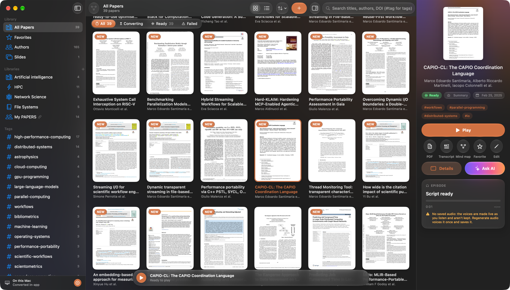
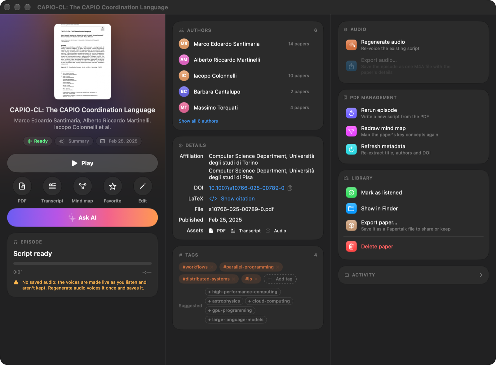
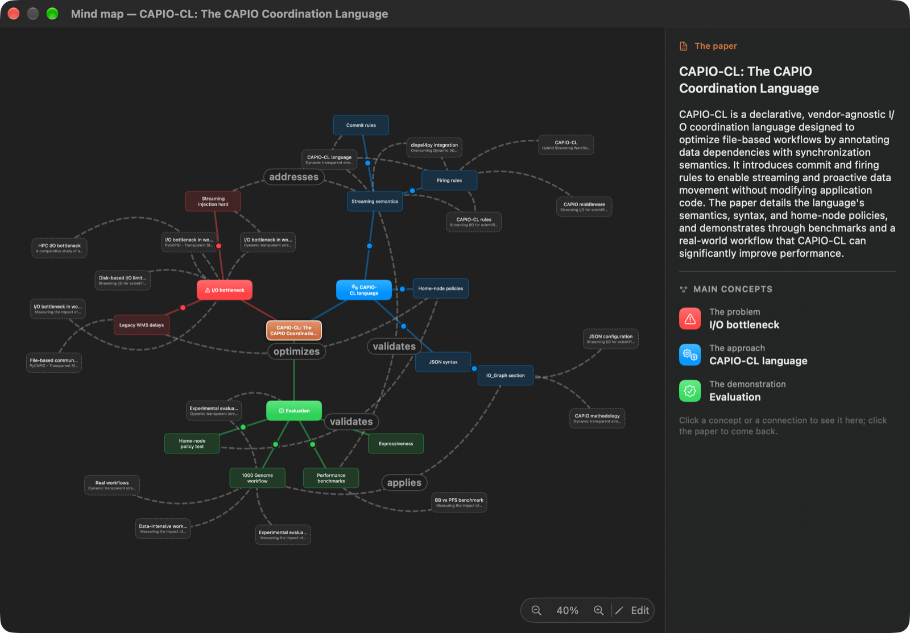
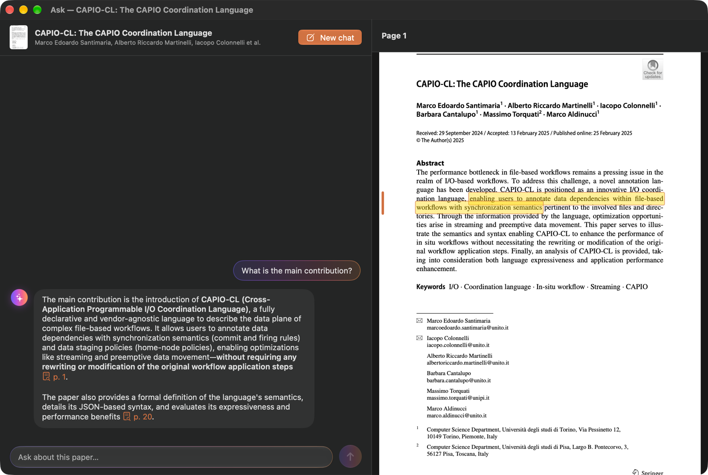
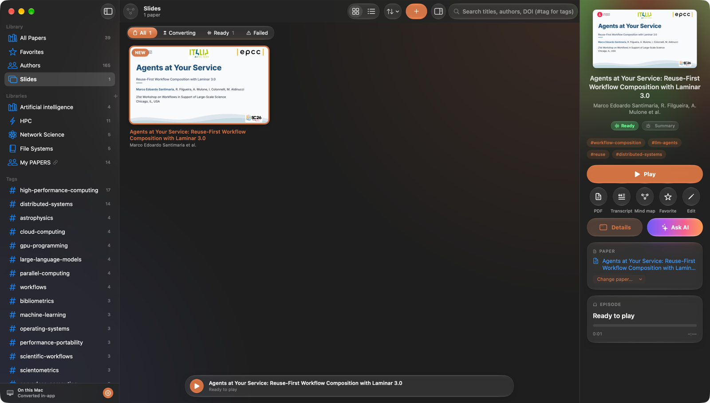

# Papertalk


-D07040)
[](https://github.com/marcoSanti/papertalk/actions/workflows/release.yml)

**Turn a scientific paper into a podcast, on your Mac.** Drop in a PDF: an LLM writes a
conversation between an interviewer and one of the paper's authors, and neural voices running
on your machine read it aloud.

> [!WARNING]
> This app is vibecoded. I had the need not the time. Bugs are expected and help is appreciated



## What it does

- 🎙️ **Episodes, not read-outs**: *In-depth*, *Summary* (5–60 min), *Custom*, or *Direct read*.
- 🗣️ **Pick the cast**: rename the speakers, choose voices, hear samples, set the pace.
- 🧠 **Mind maps**: each paper's key ideas as an editable graph, linked across your library.
- 💬 **Ask AI**: chat with a paper; answers cite and highlight its pages.
- 🖼️ **Slide decks**: import a presentation as PDF, charts and diagrams included.
- 🔭 **Suggested papers**: papers like yours from Semantic Scholar (a check sends it your papers' DOIs) and from your Google Scholar alert emails.
- 📚 **A real library**: covers, favourites, tags, authors, libraries, search, citations.
- 🔒 **Your setup**: any OpenAI-compatible LLM (local or hosted); voices on your Mac or on a server.
- 🌍 **Five languages**: English, Italian, Spanish, German and French.

Everything is explained in the app: **Help → Papertalk Help**.

<table>
  <tr>
    <td width="50%"><br><sub><b>Details</b>: a paper's authors, citation and tags, and every action on it.</sub></td>
    <td width="50%"><br><sub><b>Mind map</b>: the problem, the approach and the demonstration, with links to your other papers.</sub></td>
  </tr>
  <tr>
    <td width="50%"><br><sub><b>Ask AI</b>: answers cite pages, and the quoted words are highlighted.</sub></td>
    <td width="50%"><br><sub><b>Slides</b>: a talk's deck, linked to the paper it presents.</sub></td>
  </tr>
</table>

## Install

Download `Papertalk-<version>.zip` from [Releases](https://github.com/marcoSanti/papertalk/releases),
unzip it and move **Papertalk.app** to Applications. It's ad-hoc signed, so the first time,
right-click it and choose **Open**. After that it can update itself (Settings → General).

On first launch a short setup asks where the library lives, which LLM to use (URL, key, model)
and where voices are made. Everything can be changed later in **Settings** (⌘,). Voices on the
Mac download about 120 MB of models with the first episode.

## Using it

Import with **File → Import PDF…** (⌘O), the **+** button, or by dropping a PDF on the library.
Pick a depth, confirm the voices, and keep working: it converts in the background and notifies you when the episode is ready.

| Key | In the library |
| --- | --- |
| Space or Return | Play or pause the selected paper |
| Arrow keys | Move around the grid |
| Delete | Delete the selected paper (after asking) |
| ⌘O | Import a PDF |
| ⇧⌘O | Import a Papertalk paper (`.papertalk`) |
| ⌘, | Settings |

## Voices on a server

Voicing on the Mac needs about 0.5 GB of memory. To spare an 8 GB Mac, **Settings → Voices** can
use an OpenAI-compatible text-to-speech server running Kokoro instead, such as
[Kokoro-FastAPI](https://github.com/remsky/Kokoro-FastAPI) (`http://<host>:8880/v1`) or
[Open WebUI](https://docs.openwebui.com/) (`http://<host>:3000/api/v1`).

## Sharing a library between Macs

Run the bundled storage server on any Mac or Linux machine with Swift 6.2, then set
**Settings → Server Settings** to `http://<host>:9170`:

```bash
PAPER2POD_STORAGE_TOKEN=<secret> ./app.sh server
```

Enter the same token in **Settings → Server Settings**. Without a token the server accepts only
connections from the machine it runs on.

<details>
<summary>Server options and API</summary>

Environment: `PAPER2POD_STORAGE_PORT` (default `9170`), `PAPER2POD_STORAGE_HOST` (default
`0.0.0.0` with a token, `127.0.0.1` without), `PAPER2POD_STORAGE_ROOT` (default
`~/.paper2pod/storage`) and `PAPER2POD_STORAGE_TOKEN` (bearer token, entered in the app too).
Setting the host to `0.0.0.0` without a token lets anyone on the network read and delete the
library. One upload can be at most 1 GB.

It's a flat key/value store: `GET /` lists keys; `GET`, `PUT`, `DELETE` and `HEAD` on `/<key>`
work on one file (`papers/<id>/paper.json`, `papers/<id>/turns/<n>.wav`, …). It only stores
files; conversion happens in the app.

</details>

## Your data

- Library: `~/Library/Application Support/papertalk/papers/`, one `.papertalk` package per paper
  (movable in **Settings → General → Library folder**).
- Voice models: `~/.cache/fluidaudio/`.
- API keys: the macOS Keychain only.
- Optional defaults from the environment: `LLM_BASE_URL` (or `OPENWEBUI_BASE_URL`),
  `PAPERTALK_MODEL`, `LLM_API_KEY` (or `OPENWEBUI_API_KEY`, `PAPERTALK_API_KEY`),
  `PAPERTALK_SERVER_URL`, `PAPERTALK_API_TOKEN`.

**Settings → Clear Data** erases the library or the voice models.

## Known issues

> [!WARNING]
> **macOS may close Papertalk while it makes voices on the Mac.** A bug in the speech library
> (FluidAudio 0.17.7, upstream #817, #844) can make one call eat tens of gigabytes of memory.
> Papertalk reloads the model every 25 pieces, which has avoided it in every test so far.
> Nothing is lost: voicing resumes where it stopped. [Voices on a server](#voices-on-a-server)
> avoid it entirely.

## Building and contributing

Needs macOS 26 and Xcode with Swift 6.2.

```bash
./app.sh run        # debug build of dist/Papertalk.app, then open it
./app.sh test       # the test suite, about ten seconds, no network needed
./app.sh release    # optimized build, zipped
```

Read [AGENTS.md](AGENTS.md) first: it has the rules, and links to the
[development guides](docs/development/) on the code layout, tests and releases. A Linux build (GTK 4 AppImage) is in progress under `linux-dev/`.
When reporting a bug, include the **Activity** log from the paper's details.
